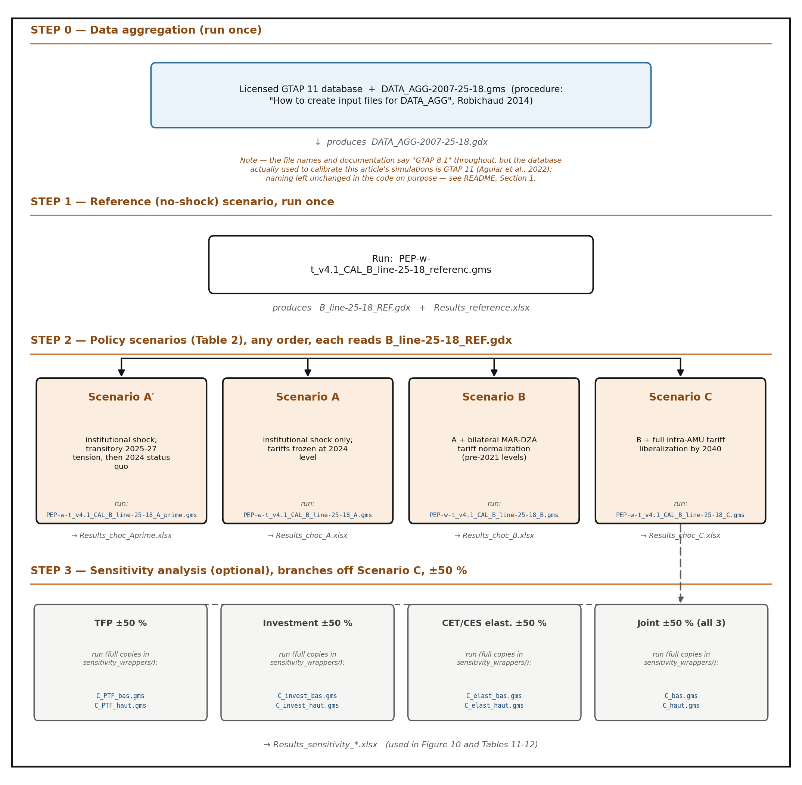

# Impact of United Nations Resolution 2797

Code and data accompanying the article on the economic and trade effects of
UN Security Council Resolution 2797 and of alternative Maghreb (Arab Maghreb
Union, AMU) integration scenarios.

The repository has two independent parts:

| Folder | Contents | Software |
|---|---|---|
| [`gravity_model/`](gravity_model) | PPML gravity estimations of intra-AMU trade and trade-potential calculations | Python |
| [`cge_model_data/`](cge_model_data) | PEP-w-t v4.1 computable general equilibrium (CGE) model, data, parameters, scenario code and simulation results | GAMS |

---

## 1. Gravity model (`gravity_model/`)

Re-estimation of the intra-AMU gravity model with Poisson pseudo-maximum
likelihood (PPML), and computation of the ratio of actual to potential trade
for the five AMU countries.

**Data.** CEPII Gravity Database, public version V202211 (Conte, Cotterlaz &
Mayer, 2022), 2000–2019. The scripts download it automatically from the CEPII
website, so no data file is stored here.

| File | Purpose |
|---|---|
| `est-graviti-pyton.txt` | Downloads and filters the CEPII panel, builds the variables and estimates four PPML models: exports and imports, each as a baseline (original specification, no fixed effects) and as structural gravity (exporter-year and importer-year fixed effects). Includes a robustness check with BACI flows. |
| `estimation+potencill.txt` | Single end-to-end script: the same estimations plus the actual/potential trade ratios (AMU aggregate, by exporter and bilateral), tables (`potentiel_agrege_uma.csv`, `potentiel_bilateral_uma.csv`) and figures. |
| `Parsimonious gravity specification.txt` | Structural-gravity PPML without the higher-order interaction terms, keeping only the five core covariates (`fta_wto`, common colonizer, common official language, contiguity, log distance). Reproduces the "Parsimonious Specification (No Interactions)" column of Tables 3 and 4. |
| `README.txt` | Short usage note. |

**How to run.** The scripts are stored as `.txt` files; they are plain Python.

```bash
pip install pandas numpy pyfixest pyarrow
python est-graviti-pyton.txt            # the four estimations
python estimation+potencill.txt         # estimations + trade potential, tables and figures
python "Parsimonious gravity specification.txt"
```

Comments in the first two scripts are in French.

---

## 2. CGE model (`cge_model_data/`)

Simulations built on **PEP-w-t**, the standard multi-region, recursive-dynamic
world CGE model of the Partnership for Economic Policy (PEP), calibrated on a
**25-region, 18-commodity** aggregation of the GTAP database.

> **GTAP version.** File names and in-code comments inherited from the base
> model refer to "GTAP 8.1". The database actually used to calibrate the
> simulations is **GTAP 11** (Aguiar et al., 2022). Read every "GTAP 8.1"
> reference as GTAP 11.

### Scenarios

| Snippet | Scenario |
|---|---|
| `referenc.gms` | Reference (no-shock) path, including the permanent 2021 Morocco–Algeria tariff rupture. Run first. |
| `A_prime.gms` | **A′**: institutional/geopolitical shock with transitory 2025–2027 tensions, then return to the 2024 tariff status quo. |
| `A.gms` | **A**: institutional shock only; tariffs frozen at their 2024 level. |
| `B.gms` | **B**: A + bilateral Morocco–Algeria tariff normalization (pre-2021 levels). |
| `C.gms` | **C**: B + full, progressive intra-AMU tariff liberalization by 2040. |

The snippets are `$INCLUDE`d into the calibrating-baseline model
`PEP-w-t_v4.1_CAL_B_line-25-18.gms`; they are not runnable on their own.

### Sensitivity analysis (±50 %, around Scenario C)

Ready-to-run model files `PEP-w-t_v4.1_CAL_B_line-25-18_C_<variant>.gms` and
their results `Results_choc_C_<variant>.xlsx`:

| Variant | Shock varied |
|---|---|
| `PTF_bas` / `PTF_haut` | Total factor productivity, ±50 % around +0.12 % |
| `invest_bas` / `invest_haut` | Investment, ±50 % around +1.5 % |
| `elast_bas` / `elast_haut` | CET/CES elasticities, ±50 % around +5 % |
| `bas` / `haut` | All three shocks jointly, ±50 % |

(`bas` = low, `haut` = high.)

### Other files

| File | Purpose |
|---|---|
| `INIT.gms` | Model initialization (included by the model files) |
| `DATA_AGG-2007-25-18.gms`, `HAR2GDX.gms` | Data aggregation and HAR-to-GDX conversion |
| `XLS_RESULTS-25-18.GMS` | Export of results to Excel |
| `basedata2017.gdx`, `parameters2017.gdx`, `DATA_AGG-2007.gdx` | Database and parameter files (`basedata2017.gdx`, 121 MB, is stored with Git LFS) |
| `VAL_PAR-25-18.xls`, `PPP.xlsx` | Parameter values and PPP data |
| `MODINTG.gpr` | GAMS IDE project file |
| `README_GAMS_replication.md` | Detailed replication guide |
| `README_.png` | Workflow diagram (below) |

### How to reproduce

Requirements: a licensed GAMS installation with a compatible NLP/MCP solver.
Regenerating the aggregated data from scratch also requires a GTAP licence.

1. **Data aggregation** (once): build `DATA_AGG-2007-25-18.gdx` from the GTAP
   database with `DATA_AGG-2007-25-18.gms`.
2. **Reference scenario** (once): run the model with `referenc.gms`. This
   produces `B_line-25-18_REF.gdx`, which every other run reads.
3. **Policy scenarios**: run A′, A, B and C in any order. Each produces a
   `Results_choc_*.xlsx` file.
4. **Sensitivity analysis** (optional): run the eight
   `PEP-w-t_v4.1_CAL_B_line-25-18_C_<variant>.gms` files.

See [`cge_model_data/README_GAMS_replication.md`](cge_model_data/README_GAMS_replication.md)
for full details.



---

## Cloning

`basedata2017.gdx` is stored with [Git LFS](https://git-lfs.com). Install it
before cloning, or the file will be a small pointer instead of the data:

```bash
git lfs install
git clone https://github.com/yassineelhajoui-stack/impact-of-United-Nations-Resolution-2797.git
```

The file can also be downloaded directly from its page on GitHub.

## Licence and credits

- The base PEP-w-t model code is by Robichaud, Lemelin, Decaluwé and
  Maisonnave (PEP) and is distributed under
  [CC BY-NC-SA 3.0](https://creativecommons.org/licenses/by-nc-sa/3.0/). This
  repository modifies and extends it and does not claim authorship of the base
  model.
  - Robichaud, V., Lemelin, A., Decaluwé, B., & Maisonnave, H. (2013).
    *PEP-w-t: The PEP Standard Multi-Region, Recursive Dynamic World CGE
    Model*, version 4.0.
  - Lemelin, A., & Robichaud, V. (2014). *PEP-w-t: Update, with a Reference
    Scenario*, version 4.1.
- Gravity data: Conte, M., Cotterlaz, P., & Mayer, T. (2022). *The CEPII
  Gravity Database*. CEPII.
- GTAP database: Aguiar, A., Chepeliev, M., Corong, E., & van der Mensbrugghe,
  D. (2022). The Global Trade Analysis Project (GTAP) Data Base: Version 11.
  *Journal of Global Economic Analysis*, 7(2).

## Contact

For questions on the scenarios or on reproducing the results, please contact
the corresponding author.
